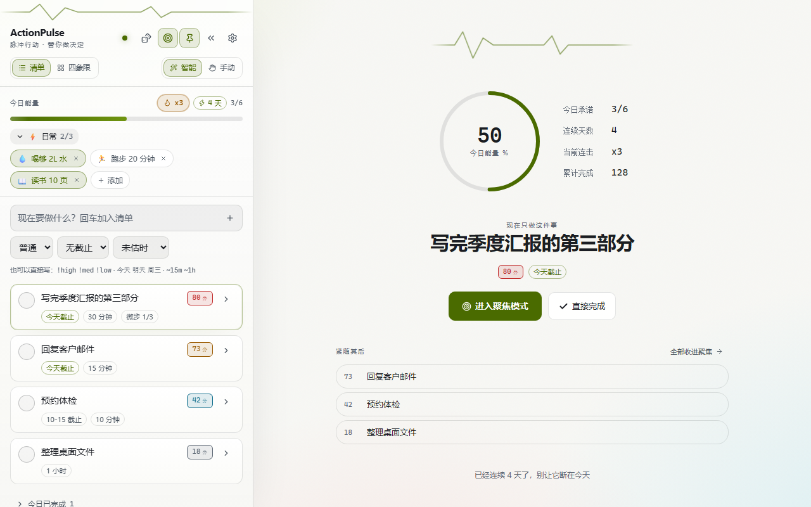
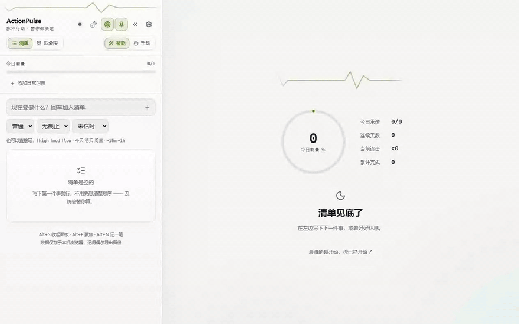
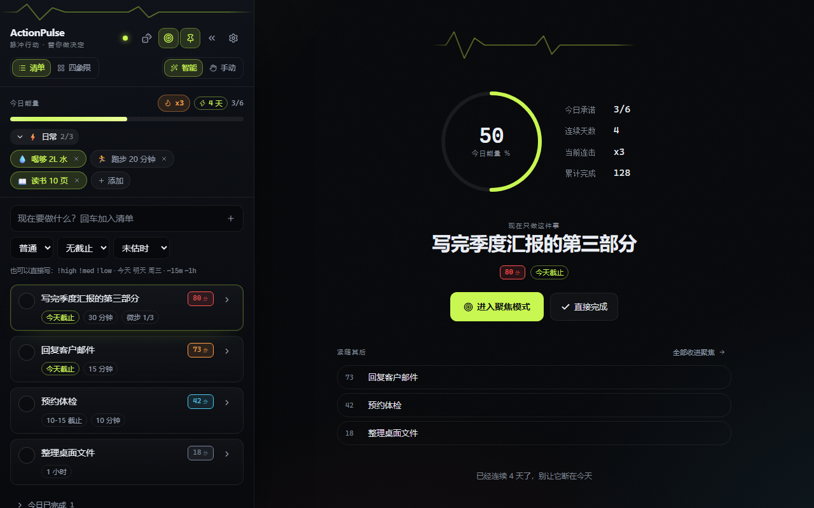
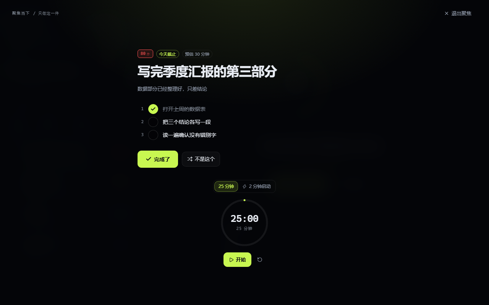
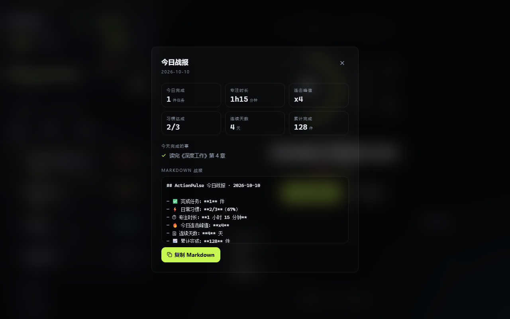
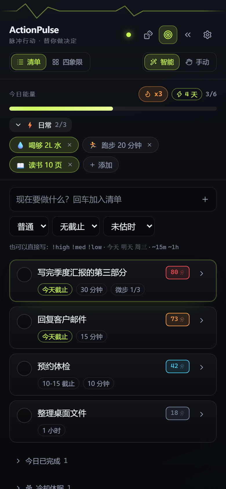
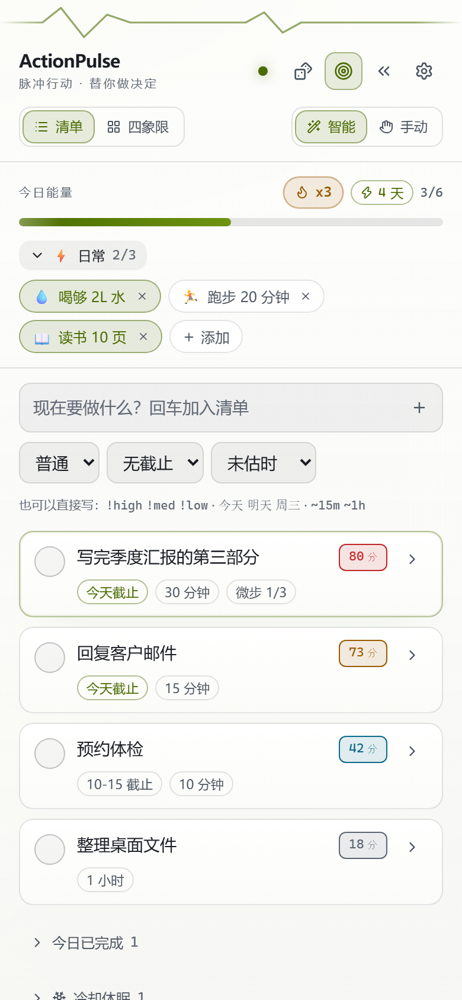

<div align="center">

  

  

  <h1>ActionPulse</h1>

  <p><b>Stop deciding. Start doing.</b><br />
  A local-first task cockpit that turns <i>I do not know where to start</i> into <i>I am already doing it</i>.</p>

  <a href="https://github.com/Batianxieshen1/ActionPulse/actions/workflows/ci.yml"></a>
  <a href="LICENSE"></a>
  
  

  <a href="README.md">English</a> · <a href="README.zh-CN.md">简体中文</a>

</div>

---

## The problem

Most todo apps are **storage**. They help you write things down and then hand the hard part straight back to you:

> You open the app, see 27 items, feel tired, and close it.

That gap — between *knowing* what to do and *actually starting* — is where tasks die. ActionPulse is designed around that gap, not around storing tasks.

Three commitments follow from it:

1. **The list must tell you what to do next — and you must be able to see why.** No black-box ranking.
2. **Starting must be cheaper than deciding.** Focus mode, a 2-minute kickstart, and a weighted blind box do the deciding for you.
3. **The list must never become a source of guilt.** Habits never pile up overdue, and stale tasks hibernate instead of rotting in front of you.

---

## Screenshots

<table>
  <tr>
    <td width="50%"><br /><sub><b>Dark — Pulse Console</b></sub></td>
    <td width="50%"><br /><sub><b>Light — Daylight Desk</b></sub></td>
  </tr>
  <tr>
    <td><br /><sub><b>One-thing focus mode</b></sub></td>
    <td><br /><sub><b>Daily debrief</b></sub></td>
  </tr>
  <tr>
    <td><br /><sub><b>Mobile — dark</b></sub></td>
    <td><br /><sub><b>Mobile — light</b></sub></td>
  </tr>
</table>

---

## Features

### Explainable urgency, not a black box

Every task gets a score you can reason about; expand a card to see exactly which component contributed what:

```
score = clamp( round( (35·I + 40·D + 15·Q + 10·A) / 108 × 100 ), 0, 100 )

  I  importance        high / medium / low
  D  deadline pressure overdue 1.2 · today 1.0 · tomorrow 0.7 · ≤3d 0.4 · later or none 0.1
  Q  quick win         ≤15 min 1.0 · ≤60 min 0.5 · longer or untimed 0.2
  A  age factor        min(daysSinceCreated / 7, 1)   ← rescues stalled tasks
```

Weights are covered by unit tests that assert the documented ordering actually holds (a `high + overdue` task must outrank a `low + someday` one), so the formula cannot silently drift.

### One-thing focus mode

A full-screen stage that shows exactly one task. Everything else disappears. Hit **not this one** to swap it out, or **done** to move on. If the task feels too big, break it into 3–5 micro-steps in place — offline verb templates by default, or your own LLM if you configure one.

### 🎲 Blind box — for when you cannot choose

When the top of your list all feels equally impossible, roll the dice. It picks one task from your **top three** and drops you straight into focus mode.

The roll is **weighted by urgency**, not uniform — a uniform 1-in-3 roll would throw away the entire ranking. You get randomness to break the paralysis, without discarding the algorithm.

### ⚡ 2-minute kickstart

The hardest part of any task is the first two minutes. Start a 120-second timer with the prompt *just do two minutes — you can stop after*. When it rings you can stop, or one tap refills it into a full 25-minute pomodoro and you ride the momentum.

Focus time is banked even if you bail early, so no effort goes uncounted.

### ⚡ Daily rituals

A compact row of pills at the top of the panel for the things you do every day. Tap to complete, tap again to undo.

Want to act on one right now? The collapsed row offers the next unfinished ritual; expand it to focus a specific one. Focus completion checks off today's ritual without creating a duplicate task.

- **Schedules: daily / weekdays / a specific weekday.** Due-ness is derived from today — no duplicated task instances, so the sync algebra stays untouched, and a weekly ritual never inflates today's promise on its off days.
- **They never go overdue.** A habit that was not done yesterday does not turn into a debt today. Cross-day reset is *derived* from the current date, so there is no reset timer to misfire.
- **Sync cannot conflict.** Completion history is a grow-only set, so two devices merge by set union — commutative, associative, idempotent. Your phone and laptop can both check things off offline and they will always converge.
- **Finishing all of them does not snatch the row away.** It waits 1.5 seconds before collapsing so the completion registers.

### 🧊 Backlog hibernation

Anything untouched for **14 days** with no deadline quietly moves to a collapsed *cooling* section at the bottom. It stops competing for attention, but nothing is deleted.

Each hibernating task offers three exits: **give it a date**, **wake it**, or **delete it**. Waking alone is a trap — do nothing and it hibernates again in 14 days. The hint says so.

Tasks **with** a deadline never hibernate: that is a commitment to someone else, and hiding it is worse than showing it.

### 🏆 Daily debrief

When everything due today is clear, you get a one-line banner — not a modal. Tap the energy bar any time for the full report: tasks done, focus minutes, peak combo, habit completion, current streak. Copy it as Markdown with one click. The report also shows the last-7-days estimate mix — whether the quick-win factor keeps feeding you small tasks is now checkable in data.

### ⌨️ Natural-language capture

Type the metadata right into the title. No dropdown, no mouse:

```
Write Q3 report !high 明天 ~30m
```

| Syntax | Meaning |
| :--- | :--- |
| `!high` `!med` `!low` (also `!h` `!m` `!l`) | importance |
| `今天` `明天` `后天` `周一`…`周日` (Chinese date keywords) | due date |
| `~5m` `~30m` `~1h` `~20min` | estimate — **open range**, so `~45m` works too |

What was parsed shows up live as chips below the input, because a parser you cannot see is a parser you cannot trust. Text markers beat the dropdowns, and they never overwrite the dropdowns’ remembered values.

> **`周一` always resolves to the *next* Monday, including today — never a date in the past.**
> Otherwise typing 周一 on a Wednesday would instantly mark the task overdue and shoot it to the top of the list: you save effort with natural language and the app punishes you for it.

### Dark and light, with WCAG AA enforced by a test

Two full palettes with a one-to-one token mapping, following the system preference by default. Light mode is **not** an inversion of dark — the dark accent (electric lime) has a contrast ratio of only **1.24:1** on white, so the light theme had to be designed separately.

`tests/theme.test.ts` parses the CSS, composites shell → panel → card, and asserts every text token clears **4.5:1** on every surface in both themes. Writing that test immediately exposed that the *original dark theme* failed AA on two tokens; both were corrected.

Switching themes never flashes: an inline script in `<head>` sets `data-theme` before the first paint. Verified by blocking all JavaScript and asserting the attribute is already correct with React not yet mounted.

---

## Quick start

Requirements: **Node 20+**. Nothing else — no database, no Docker, no account.

> No Node? [Try it in your browser](https://batianxieshen1.github.io/ActionPulse/) (client-only demo) — your data stays in your own browser; no multi-device sync and no AI breakdown, everything else works.

```bash
git clone https://github.com/Batianxieshen1/ActionPulse.git
cd ActionPulse
npm install
npm start
```

The terminal prints a URL containing a pairing token. Open it on your desktop — and on your phone, if you are on the same Wi-Fi:

```
▶  ActionPulse
  ├─ Desktop:  http://localhost:5273/?token=<your-token>
  ├─ Phone:    http://192.168.1.42:5273/?token=<your-token>   (same Wi-Fi)
  └─ Data:     ./data/state.json
```

### Scripts

| Command | What it does |
| :--- | :--- |
| `npm start` | Build + serve everything on port 5273 |
| `npm run dev` | Vite HMR on 5273 + API on 5274, one command |
| `npm test` | 349 unit tests |
| `npm run build` | Typecheck + script syntax guard + Vite build |
| `npm run gen:icons` | Regenerate PWA icons |

---

## Multi-device sync

Sync is **peer-to-peer over your own LAN**. There is no cloud, no account, and no server you do not own.

```
   Phone  ──┐
            ├──►  node:http server on your machine  ──►  ./data/state.json
   Laptop ──┘         (SSE push + optimistic locking)
```

**The conflict model.** Each task merges as a whole by last-write-wins on `updatedAt` — if two devices edit different fields of the same task at nearly the same time, the newer whole task wins; that simplicity is deliberate. Habit completions merge field-by-field as a grow-only set, so they cannot conflict. Deletes leave tombstones so a removed task cannot be resurrected by a device that had not seen the delete yet. Writes carry the revision they were based on — if it is stale the server answers `409` with the current state, the client merges and retries (up to 3 times). Because merge is commutative and idempotent, retries converge instead of duplicating.

**Settings are deliberately never synced.** Turning your phone to silent should not mute your laptop. Theme, volume, and pomodoro length stay per-device.

**Offline is the normal case.** The client is local-first: it works with no server, no network, and no Wi-Fi, and reconciles when it next reaches one.

### What you give up by staying local

| | LAN only (default) | Behind a VPN such as Tailscale |
| :--- | :--- | :--- |
| Reachable from anywhere | No — same Wi-Fi only | Yes |
| Your machine must be awake | Yes | Yes |
| HTTPS | No | Yes, via `tailscale serve` |
| Service worker / offline cache on phone | No (not a secure context) | Yes |
| Data leaves your home | Never | Never (still your devices) |

If you want access from anywhere, putting both devices on a private mesh VPN is the smallest change: the phone then reaches the same server from any network. Full instructions and trade-offs — including why plain port forwarding is a bad idea here — are in [docs/DEPLOYMENT.md](docs/DEPLOYMENT.md).

---

## Architecture

```
src/domain/       pure functions, no React, no I/O  ← the actual product logic
  urgency.ts        scoring
  merge.ts          LWW + tombstones + grow-only sets
  habits.ts         daily rituals
  nlp.ts            natural-language capture
  hibernation.ts    backlog ageing
  pick.ts           weighted blind box
  debrief.ts        daily report
src/store/        reducer + selectors (single source of truth)
src/sync/         client, SSE, optimistic locking
src/ui/           presentational components
server/           zero-dependency node:http backend (imports only node: builtins)
```

The domain layer is deliberately free of React and I/O, so the hard parts — merge algebra, date boundaries, parsing — are plain functions with plain tests.

The backend imports **only** `node:` builtins. That was a constraint, not an accident: it means you can copy `server/` to any machine that has Node and run it, with no `npm install` and no lockfile drift.

### Tech stack

React 19 · TypeScript · Vite 8 · Tailwind CSS 4 · lucide-react · canvas-confetti, with Web Audio for the chime (no audio files) and a `node:http` backend.

---

## Testing

```
tests/            349 unit tests across 22 files (vitest)
```

The suite covers the parts that are actually hard to get right:

- **Merge algebra** — commutativity, idempotence, and the case where a newer scalar field must not erase the other device’s completion history.
- **Date boundaries** — weekdays resolving forward across a year boundary, cross-day habit reset, hibernation at exactly 14 days.
- **Parser edges** — markers glued to CJK text with no spaces, titles that legitimately contain `!` or `~`, and the empty-title fallback.
- **Theme contrast** — WCAG ratios computed by compositing real surfaces, plus a guard that no colour literal sneaks back into a component.
- **The service worker actually parses** — every file in `public/` is run through a real JavaScript parser in CI, because a bundler never touches that directory and a syntax error there used to pass 183 green tests while the worker silently failed to register.

---

## FAQ

<details>
<summary><b>Why not just use Todoist / Things / Apple Reminders?</b></summary>

They are better than this at being todo apps. ActionPulse is not trying to win that comparison — it optimises for a narrower problem: getting started. If your problem is that you already know what to do and are not doing it, a longer feature list will not help.
</details>

<details>
<summary><b>Is the interface available in English?</b></summary>

Yes — since v2.3.0 the UI is bilingual (Chinese / English), switchable in settings; the preference is per-device. The natural-language capture markers stay Chinese (`!high 今天 ~15m`), and the engineering docs are bilingual too.
</details>

<details>
<summary><b>Will you add labels / projects / recurring tasks?</b></summary>

Probably not. ActionPulse's edge is getting started, not managing — every managing feature added dilutes that. Recurring work already exists as daily rituals (which never go overdue); for the rest, better tools exist.
</details>

<details>
<summary><b>Is my data sent anywhere?</b></summary>

No. State lives in your browser’s local storage and in `./data/state.json` on the machine you run the server on. The only outbound request the app ever makes is to an LLM endpoint, and only if you configure one — it is off by default and falls back to offline templates.
</details>

<details>
<summary><b>Can I use it without the server at all?</b></summary>

Yes. `npm start` is the full experience, but the client is local-first: open the built page anywhere and it works standalone. You only lose multi-device sync.
</details>

<details>
<summary><b>Why does my phone not get offline caching?</b></summary>

Because `http://192.168.x.x` is not a secure context, so browsers refuse to register a service worker. Serving it over HTTPS — for example through a mesh VPN — fixes it. The desktop side runs on `localhost`, which is a secure context, so caching works there.
</details>

<details>
<summary><b>Is there an app store version?</b></summary>

No. It is a PWA, installable from the browser. On a secure context it also runs offline.
</details>

## Development log

The engineering notes behind this project — pre-implementation spec audits, the plan for the light theme, and the list of things that looked fine and turned out not to be — live in **[docs/dev-log](docs/dev-log/README.md)**.

They include a service worker that silently failed to register while 183 tests stayed green, a WCAG failure in the original dark theme that only surfaced once contrast was actually asserted — and an ongoing watch on the algorithm's own assumptions: whether the quick-win factor trains you to keep picking peas ([q-factor-tradeoff](docs/dev-log/q-factor-tradeoff.md)).

---

## License

MIT — see [LICENSE](LICENSE).
